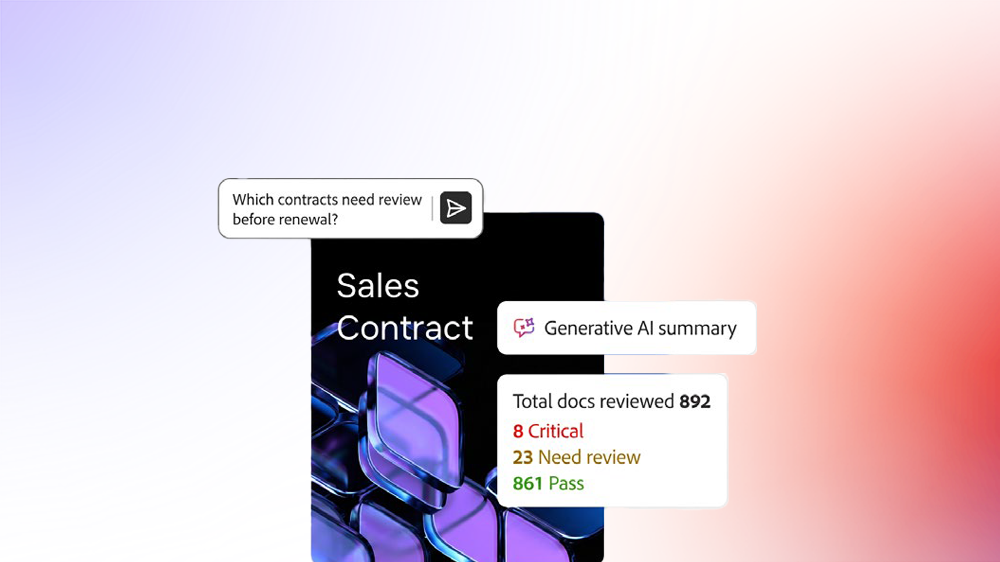
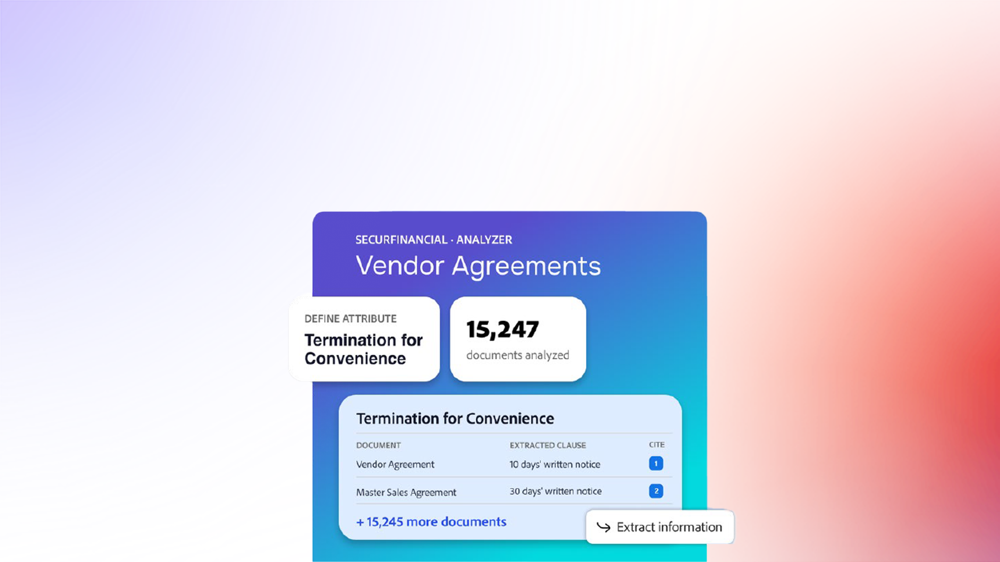
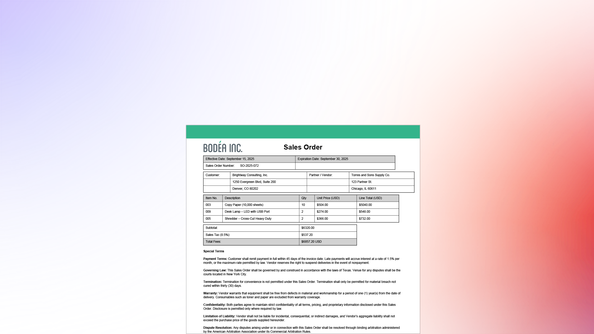
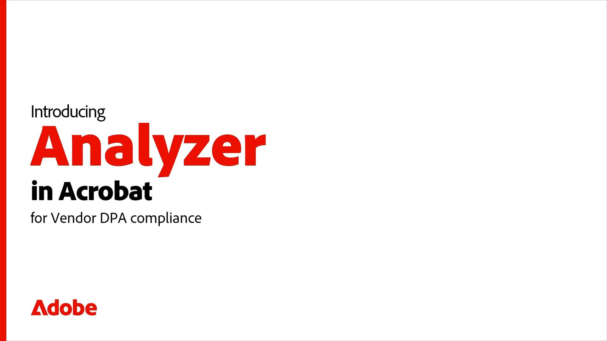

# Analyzer in Acrobat Studio - Übersicht

Lerne, wie du mit Adobe Analyzer in Acrobat Studio komplexe Dokumente in klare Erkenntnisse verwandelst. Diese kurzen Tutorials erleichtern dir den Einstieg, zeigen erweiterte Funktionen auf und zeigen, wie du die Software in der Praxis einsetzt.

[!BADGE Informativ]{type="Watch overview video" url="https://video.tv.adobe.com/v/3503972"}

## Neue Funktionen

>[!BEGINTABS]

>[!TAB Erste Schritte]

[Erste Schritte](get-started.md), indem Sie lernen, wie strukturierte, zitierte Daten aus großen Dokumentmengen abgerufen werden können.

>[!TAB Sammlungen verwenden]

Erfahren Sie, wie Sie manuelle und verknüpfte [Sammlungen](collections.md) erstellen, Attribute anwenden und Dokumente organisieren, wenn Ihr Inhalt wächst.

>[!TAB Mit Attributen arbeiten]

Erfahren Sie, wie Sie [Attribute](attributes.md) mit Analyzer in Acrobat Studio erstellen, testen und optimieren.

>[!TAB Erweiterte Funktionen entdecken]

Erfahren Sie, wie Sie [extrahierte Daten exportieren, eine Sammlung freigeben, zwei Dokumente vergleichen und AI Assistant](advanced.md) für schnelle Ad-hoc-Fragen verwenden.

>[!TAB Anwendungsfälle in Aktion]

Erfahren Sie mehr über echte [Anwendungsfälle](use-cases/use-case-overview.md) und wie verschiedene Teams Analyzer in Acrobat Studio nutzen, um intelligenter und schneller zu arbeiten.

>[!ENDTABS]

## Essentials

Grundlagen. Erfahren Sie, wie Sie Analyzer in Acrobat Studio verwenden, um Ihre Dokumente schnell zu verstehen, zusammenzufassen und mit ihnen zu interagieren.

<table style="table-layout:fixed">
<tr>
  <td>
    
    

    <a href="get-started.md"><strong>Erste Schritte</strong></a>
    

    Erfahren Sie, wie Analyzer in Acrobat Studio Ihnen hilft, strukturierte, zitierte Daten aus großen Dokumentmengen herauszuziehen.
     
  </td>
  <td>
    
    

    <a href="collections.md"><strong>Sammlungen verwenden</strong></a>
    

    Erfahren Sie, wie Sie manuelle und verknüpfte Sammlungen erstellen, Attribute anwenden und Dokumente beim Wachsen Ihrer Inhalte organisieren können.
     
  </td>
  <td>
    
    

    <a href="attributes.md"><strong>Mit Attributen arbeiten</strong></a>
    

    Erfahren Sie, wie Sie Attribute mit Analyzer in Acrobat Studio erstellen, testen und optimieren können.
     
  </td>
  <td>
    
    

    <a href="advanced.md"><strong>Erweiterte Funktionen entdecken</strong></a>
    

    Lernen Sie, wie Sie extrahierte Daten exportieren, eine Sammlung freigeben, zwei Dokumente vergleichen und AI Assistant für schnelle Ad-hoc-Fragen verwenden können.
     
  </td>
</tr>
</table>

## Nutzungsszenarien in Aktion

Beispiele aus der realen Welt. Erfahren Sie, wie verschiedene Teams Analyzer in Acrobat Studio nutzen, um intelligenter und schneller zu arbeiten.

<table style="table-layout:fixed">
<tr>
  <td>
    
    

    <a href="use-cases/m-and-a-post-audit.md"><strong>M&amp;A: Verträge nach einer Akquisition überwachen</strong></a>
    

    Erfahrt, wie M&amp;A-Teams umfangreiche Vertragssätze analysieren können, um wichtige Pflichten, Bedingungen und potenzielle Risiken in Minuten anstatt in Wochen zu identifizieren.
     
  </td>
  <td>
    
    

    <a href="use-cases/accelerate-revenue.md"><strong>Finanzen: Verträge für die Umsatzanerkennung und Audits prüfen</strong></a>
    

    Findet heraus, wie Finanzteams sich auf Audits vorbereiten, die Umsatzgenerierung unterstützen und Rechnungslegungsrisiken schneller identifizieren können.
     
  </td>
  <td>
    
    

    <a href="use-cases/data-privacy-risk.md"><strong>Datenschutz und Informationssicherheit: Datenschutzvereinbarungen überprüfen</strong></a>
    

    Erfahrt, wie Datenschutz- und Informationssicherheitsteams Compliance-Lücken identifizieren und Verpflichtungen mit nachverfolgbaren Ergebnissen validieren können.
     
  </td>
  <td>
    
    

    <a href="use-cases/identify-margin-erosion.md"><strong>Aufbau: Nachschussrisiken in Unterverträgen ermitteln</strong></a>
    

    Erfahrt, wie Bau- und Projektteams verpasste Änderungsaufträge, veraltete Rentabilitätskoeffizienten und Lücken beim Schutz von Unteraufträgen finden können, bevor sie die Margen beeinträchtigen.
     
  </td>
<tr>
<td>
    
    

    <a href="use-cases/vendor-risk.md"><strong>Überwachung der Informationssicherheit: Das Kreditorenrisiko wird ermittelt</strong></a>
    

    Erfahren Sie, wie Sie das Informationssicherheitsrisiko anhand von Lieferantenverträgen proaktiv identifizieren können
     
  </td>
  <td>
    
    

     
  </td>
  <td>
    
    

     
  </td>
  <td>
    
    

     
  </td>
</tr>
</tr>
</table>