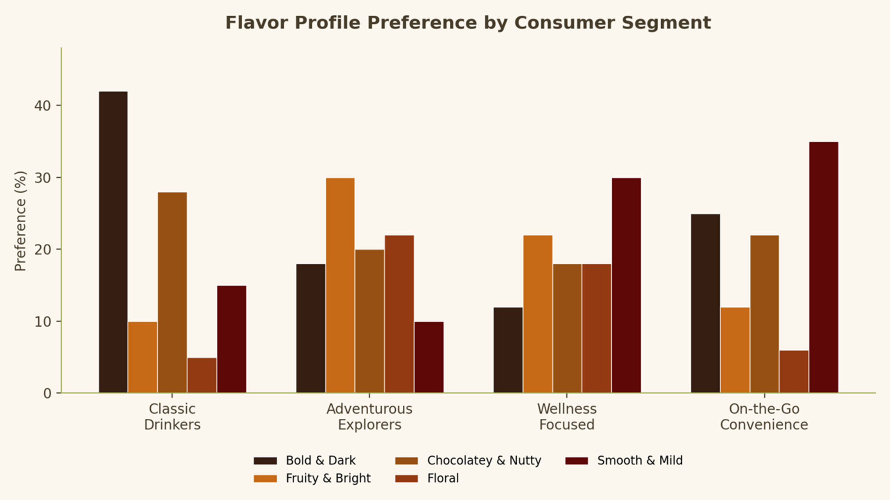

# Podcasts erstellen

Lerne, wie du mit Acrobat Studio KI-generierte Podcasts aus deinen Dokumenten und Recherche-Materials erstellst. Erfahrt, wie ihr mit Podcasts wichtige Informationen zusammenfassen, wichtige Erkenntnisse hervorheben und die Nutzung von Content unterwegs vereinfachen könnt. Sie erfahren außerdem, wie Sie die Podcast-Ausgabe für Ihre Zielgruppe anpassen und Podcasts aktualisieren, wenn neue Informationen zu Ihrem Projekt hinzugefügt werden.

>[!VIDEO](https://video.tv.adobe.com/v/3503840?enablevpops&quality=12&learn=on&hidetitle=true)

<table style="table-layout:fixed">
<tr>
  <td>
    
    

    <a href="podcast.md"><strong>Podcast erstellen</strong></a>
    

    Lerne, wie du KI-generierte Podcasts aus deinen Dokumenten und Forschungs-Materials erstellen kannst.
     
  </td>
  <td>
    
    

     
  </td>
  <td>
    
    

     
  </td>
  <td>
    
    

     
  </td>
</tr>
</table>